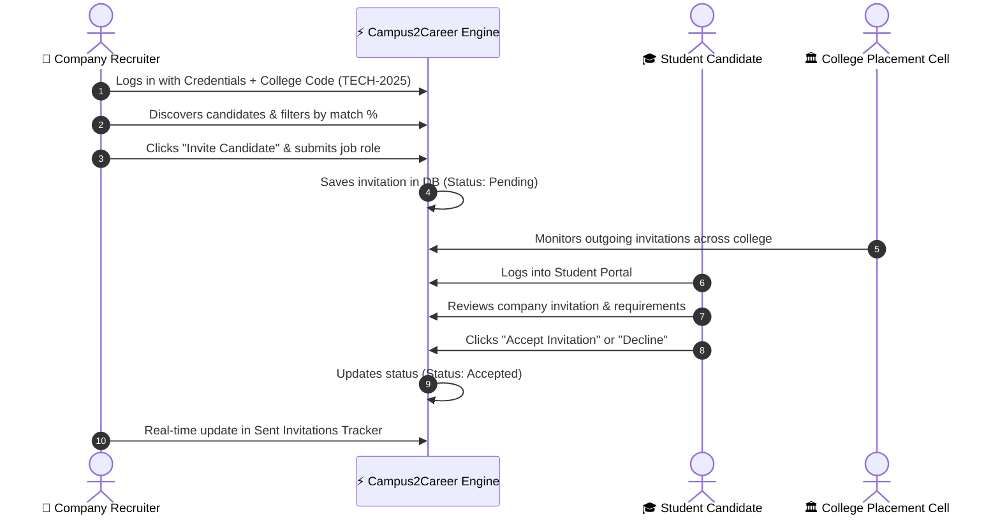

# Campus2Career AI — Student Placement and Recruitment Management System

A professional, modern, full-stack web application designed for engineering colleges, students, and corporate recruiters. Built with a modular **5-member parallel execution architecture** designed for a **20-hour hackathon execution window**.

---

## 🎯 Platform Overview

Campus2Career AI connects colleges, students, and collaborated companies through three distinct, secure, and role-governed dashboards:

1. **🏛️ College Dashboard**: Comprehensive academic & placement administration, bulk CSV data ingestion with deduplication, explainable AI Student Success Scores (0–100), cohort segmentation (e.g. *High Academics / Low Readiness*), configurable Top-N selection for placement drives, faculty intervention tracking, and recruitment monitoring.
2. **🎓 Student Dashboard**: Secure, strictly **read-only** profile mirror displaying college-verified records, transparent 4-pillar score breakdown, personalized career pathways, and an interactive **Corporate Invitations Hub** where students review and **Accept or Decline** job/internship invitations in real time.
3. **🏢 Collaborated Company Dashboard**: Scoped recruiter portal authenticated by company credentials and **Institutional College Code** (e.g., `TECH-2025`). Includes multi-facet candidate search, AI-driven opportunity-to-candidate matching engine, one-click shortlisting, direct interview invitation dispatch, and status tracking.

---

## 🤝 5-Member Team Architecture & Deliverables

```
campus2career/
├── app.py                     # Member 5: Unified integration, RBAC, Flask routing
├── database.py                # Member 1: SQLite schema, auth hashing, demo seed data
├── requirements.txt           # Member 5: Dependencies (Flask, pandas, numpy)
├── data/
│   └── demo_students.csv      # Member 1: Standardized synthetic student dataset
├── modules/
│   ├── data_integration.py    # Member 1: CSV upload, cleaning, validation, deduplication
│   ├── success_score.py       # Member 2: Explainable Student Success Score (0-100)
│   ├── risk_flags.py          # Member 2: Evidence-based placement risk flags
│   ├── trends.py              # Member 2: Institutional trends & Top-N rankings
│   ├── segmentation.py        # Member 2: 5-Cohort student segmentation engine
│   ├── insights.py            # Member 2: Personalized recommendations & career paths
│   └── matching.py            # Member 4: Opportunity candidate matching engine
├── pages/
│   ├── college_dashboard.py   # Member 3: College overview, directory, interventions
│   ├── student_profiles.py    # Member 3: Detailed student profile view & management
│   ├── company_portal.py      # Member 4: Recruiter discovery, drives, invitations
│   └── student_portal.py      # Member 4/5: Student read-only mirror & invite responses
├── static/
│   ├── css/style.css          # Design System: Cyber slate, glassmorphism, responsive
│   └── js/main.js             # Modal helpers, tabs, AJAX shortlist toggle
├── templates/                 # Jinja2 modern responsive templates
│   ├── base.html
│   ├── index.html
│   ├── login.html
│   ├── college_dashboard.html
│   ├── student_detail.html
│   ├── company_portal.html
│   ├── student_portal.html
│   ├── 404.html
│   └── 500.html
├── test_system.py             # Member 5: Automated test suite
└── README.md                  # Documentation & presentation guide
```

### Team Responsibilities Breakdown

| Role | Member | Responsibilities | Core Deliverables |
|---|---|---|---|
| **Data Engineer** | **Member 1** | Standard student ID schema, SQLite database, CSV upload & cleaning, duplicate detection, demo datasets. | `database.py`, `data_integration.py`, `data/demo_students.csv` |
| **Analytics Engineer** | **Member 2** | Explainable Student Success Score, evidence-based risk flags (*High Academic / Low Practical*), cohort segmentation, institutional trends. | `success_score.py`, `risk_flags.py`, `segmentation.py`, `trends.py`, `insights.py` |
| **Frontend Developer** | **Member 3** | College overview dashboard, student directory with multi-filters, Top-N selection, detailed profile manager, faculty interventions. | `college_dashboard.py`, `student_profiles.py`, templates |
| **Recruitment Engineer** | **Member 4** | Scoped company dashboard (College Code auth), job opportunity postings, AI candidate matching, shortlisting, invitation dispatch. | `company_portal.py`, `matching.py`, `student_portal.py` |
| **Integration & Demo Lead** | **Member 5** | Unified Flask app, role-based access control, invitation lifecycle, 1-click judge demo switchers, automated tests, presentation slides. | `app.py`, `test_system.py`, `requirements.txt`, `README.md` |

---

## ⚡ Quick Demo Logins for Hackathon Judges

The login page features **1-Click Demo Switchers** allowing evaluators to jump directly between roles without typing credentials:

| Persona | Credentials | College Code | Description |
|---|---|---|---|
| **🏛️ College Administrator** | `admin@techuniv.edu` / `admin123` | N/A | Full institutional administrative access for *Tech University*. |
| **🎓 Student: Arjun Sharma** | `arjun.sharma@techuniv.edu` / `student123` | N/A | *Star Talent / Day-1 Ready* (Score 94.2). Received Google & Microsoft invites. |
| **🔍 Student: Priya Nair** | `priya.nair@techuniv.edu` / `student123` | N/A | *High Academic (9.15 CGPA) / Low Practical Readiness* (Member 2 risk flag demo). |
| **🏢 Google Recruiter** | `recruiter@google.com` / `google123` | `TECH-2025` | Scoped to Tech University candidate database. |
| **🏢 Microsoft Recruiter** | `recruiter@microsoft.com` / `msft123` | `TECH-2025` | Scoped to Tech University candidate database. |

*Note: Students can also authenticate using their registered mobile phone number (e.g. `+91 9123456701`) or unique Roll Number (`2025CS101`).*

---

## 🧠 Explainable AI Logic & Scoring Formulas

### 1. Student Success Score (0–100)
Rather than a black-box model, the platform uses a transparent, evidence-based 4-pillar index:

$$\text{Success Score} = \text{Academic (30)} + \text{Technical Stack (30)} + \text{Practical Experience (25)} + \text{Soft Skills (15)}$$

- **Academic Pillar (Max 30)**: $\frac{\text{CGPA}}{10.0} \times 30$
- **Technical Stack (Max 30)**: Polyglot languages (10 pts) + Frameworks/Databases (10 pts) + Industry Certifications (10 pts).
- **Practical Experience (Max 25)**: Verified corporate internship (15 pts) + Public GitHub portfolio proof (10 pts).
- **Professional Brand (Max 15)**: Verified LinkedIn profile (8 pts) + Documented soft skills (7 pts).

### 2. Evidence-Based Risk Flags
- `HIGH_ACADEMIC_LOW_READINESS`: Triggered when CGPA $\ge 8.2$ but technical competency $< 14/30$ and practical experience $\le 5/25$. Directs faculty to assign practical capstone mentoring.
- `ACADEMIC_AT_RISK`: Triggered when CGPA $< 6.50$ (below corporate cutoff filters).
- `NO_INTERNSHIP_EXPERIENCE`: Final/pre-final year student lacking industry internship.
- `TECHNICAL_BREADTH_GAP`: Fewer than 2 programming languages or modern frameworks recorded.
- `NO_GITHUB_PORTFOLIO`: Missing public code repository proof.

### 3. Student Cohort Segmentation
- **Star Talent / Day-1 Ready**: Overall score $\ge 82$, CGPA $\ge 7.8$, verified internship & GitHub code.
- **High Academic / Low Practical**: CGPA $\ge 8.2$ with low practical frameworks or internships.
- **Practical Builders**: High coding/internship score ($\ge 18$) with moderate CGPA ($6.5 - 7.9$).
- **Emerging Contenders**: Balanced moderate foundation ($60 - 75$) ready for interview polishing.
- **Needs Priority Support**: CGPA $< 6.5$ or overall score $< 48.0$.

### 4. Recruiter Talent Matching Engine
Compares candidate profiles against specific company opportunity requirements:
- **Skill Match (50% weight)**: Overlap between required skills and student's languages/frameworks.
- **Academic Cutoff (25% weight)**: Ratio against minimum CGPA threshold.
- **Branch Alignment (15% weight)**: Candidate department vs eligible branches.
- **Practical Experience (10% weight)**: Relevant internship bonus.

---

## 🔄 End-to-End Recruitment Invitation Workflow



---

## 🚀 Running the Application Locally

### Prerequisites
- Python 3.9+
- Pip

### 1. Install Dependencies
```bash
pip install -r requirements.txt
```

### 2. Run the Application
```bash
python app.py
```

The application starts on `http://127.0.0.1:5000` with the SQLite database automatically initialized and seeded with rich demo datasets.

### 3. Run the Automated Test Suite
```bash
python test_system.py
```

---

## 🛡️ Security & Role-Based Access Control (RBAC)

1. **Backend Enforcement**: Route handlers verify session roles (`college_admin`, `student`, `company`) and reject unauthorized cross-role requests with HTTP redirects and error flash messages.
2. **Student Read-Only Restriction**: Students cannot edit, modify, or delete college-verified academic records.
3. **Company Institutional Scoping**: Partnered companies must provide a valid `college_code` and can only view student profiles from institutions with which they have an active collaboration agreement.
4. **Password Hashing**: Stored using PBKDF2/SHA-256 via `werkzeug.security`.
5. **Student Consent & Privacy**: Students who opt out of placement drives are automatically excluded from corporate talent discovery queries.

---

## 🏆 Demonstration Walkthrough for Judges

1. **Step 1: College Administration**
   - Click **Demo Switcher → Tech Univ Admin**.
   - Review cohort analytics, branch trends, and segmentation bars.
   - Filter by **Critical Risk Flags** to observe students needing help.
   - Select **Top 5 Candidates** to see placement drive nominations.
   - Open student profile for `Priya Nair (2025CS102)` and observe the **High Academics / Low Placement Readiness** flag and AI remediation plan.
2. **Step 2: Company Recruitment & Invitation Dispatch**
   - Click **Demo Switcher → Google Recruiter**.
   - Note the institutional lock to *Tech University (TECH-2025)*.
   - Filter candidates by skill (`Python`) and review the **AI Match Percentage**.
   - Click **Invite Candidate** on an eligible student, fill role details, and dispatch.
3. **Step 3: Student Experience & Decision**
   - Click **Demo Switcher → Arjun Sharma** or **Priya Nair**.
   - Observe the **Read-Only Institutional Record** banner.
   - View the explainable 4-pillar score breakdown.
   - Navigate to the **Invitations Hub** and click **Accept Invitation**.
   - Observe immediate status update and confirmation banner.
